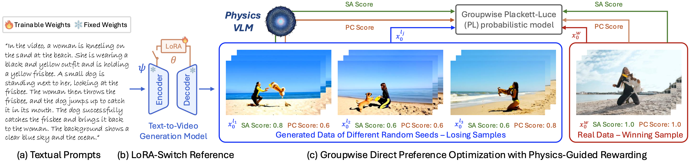
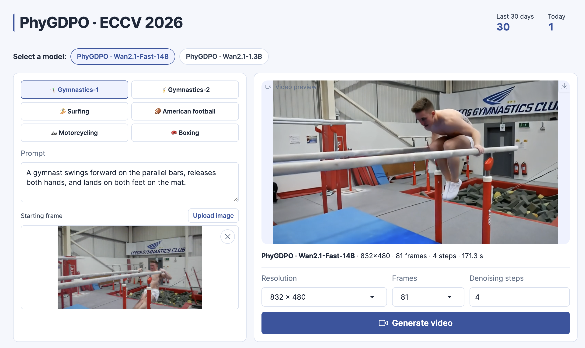
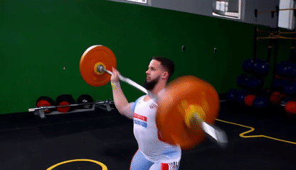
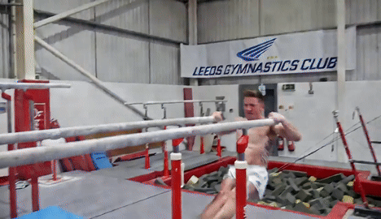
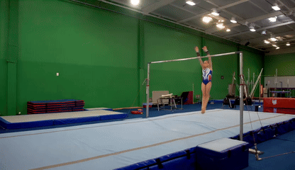
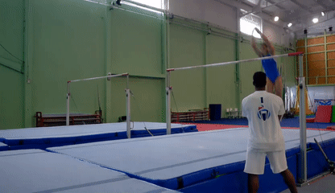

&nbsp;

<div align="center">

<p align="center">  </p>

[](https://ai.meta.com/research/publications/phygdpo-physics-aware-groupwise-direct-preference-optimization-for-physically-consistent-text-to-video-generation/)
[](https://zhuanlan.zhihu.com/p/2060200098131350370)
[](https://arxiv.org/abs/2512.24551)
[](https://caiyuanhao1998.github.io/project/PhyGDPO/)
[](https://huggingface.co/datasets/CaiYuanhao/PhyGDPO)
[](https://huggingface.co/CaiYuanhao/PhyGDPO)
[](https://huggingface.co/spaces/CaiYuanhao/PhyGDPO)

<h3>PhyGDPO: Physics-Aware Groupwise Direct Preference <br> Optimization for Physically Consistent Text-to-Video Generation</h3>

<p style="font-size: 8px;">
  Applied to the post-training of
  
  <strong>Muse Video</strong> and
  
  <strong>Gemini Omni Flash</strong>
</p>

</div>

&nbsp;

### Introduction
This part of code implements our Physics-aware Groupwise Direct Preference Optimization framework `PhyGDPO`. We develop our method based on the [Diffsynth-Studio](https://github.com/modelscope/DiffSynth-Studio) codebase, using [Wan2.1-T2V](https://github.com/Wan-Video/Wan2.1) as the base text-to-video generation model. Please refer to the official [github repo](https://github.com/modelscope/DiffSynth-Studio) of Diffsynth-Studio for more details.

<p align="center">
  
</p>

<p align="center"><strong>Figure 2:</strong> The Overview of our Physics-aware Groupwise Direct Preference Optimization framework</p>


&nbsp;
&nbsp;


## 1. Environment Installation

We recommend using Conda with Python 3.11 and a CUDA-enabled PyTorch 2.13.0 build. Run the following commands from `DiffSynth-Studio/`.

```sh
conda create -n phygdpo python=3.11 -y
conda activate phygdpo
bash install_extra_packages.sh
```


&nbsp;

## 2. Testing

### 2.1. Download Models

From `DiffSynth-Studio/`, download the Wan base models and our PhyGDPO weights with Git LFS.

```sh
git lfs install
git clone https://huggingface.co/Wan-AI/Wan2.1-T2V-1.3B models/Wan-AI/Wan2.1-T2V-1.3B
git clone https://huggingface.co/Wan-AI/Wan2.1-T2V-14B models/Wan-AI/Wan2.1-T2V-14B
git clone https://huggingface.co/CaiYuanhao/PhyGDPO models/pretrained

# Fetch the comparison figure for the 1.3B model card.
(
  cd models/Wan-AI/Wan2.1-T2V-1.3B || exit 1
  grep -Fxq 'assets/vben_1.3b_vs_sota.png filter=lfs' .git/info/attributes 2>/dev/null ||
    printf '\n%s\n' 'assets/vben_1.3b_vs_sota.png filter=lfs' >> .git/info/attributes
  git lfs pull --include=assets/vben_1.3b_vs_sota.png origin
)
```

The commands above place the weights in the following folders. For an existing installation, place the new model folder alongside the two T2V folders under `models/pretrained/`.

```text
|--models
  |--Wan-AI
    |--Wan2.1-T2V-1.3B
    |--Wan2.1-T2V-14B
  |--pretrained
    |--Wan2.1-T2V-1.3B_PhyGDPO
    |--Wan2.1-Fast-TI2V-14B_PhyGDPO
    |--Wan2.1-T2V-14B_PhyGDPO
```

### 2.2. Gradio Demo

Launch the local demo and open `http://127.0.0.1:7860`. Choose Wan-2.1-Fast-14B for image-to-video generation, or one of the two T2V models for text-to-video generation. [Online demo](https://huggingface.co/spaces/CaiYuanhao/PhyGDPO)

```sh
python apps/gradio/phygdpo/app.py
```

The demo uses one GPU for all three models. Allow about 24 GB of GPU memory for 832 × 480, 81-frame videos.

<p align="center">
  
</p>

### 2.3. Inference

Run the two commands for each model to compare the base and PhyGDPO weights with the same prompt and seed. The Fast-14B example also uses the same starting frame. Set `--num-gpus` to the number of GPUs to use.

(1) Wan2.1-T2V-1.3B

```sh
# Base model
python examples/wanvideo/inference.py --model t2v-1.3b --weights base --num-gpus 4 \
  --prompt "A weightlifter successfully completes a snatch with a 25kg barbell, holding it momentarily overhead." \
  --seed 0 --width 832 --height 480 --frames 81 --steps 50 \
  --output outputs/weightlifting_1.3B.mp4

# PhyGDPO
python examples/wanvideo/inference.py --model t2v-1.3b --weights phygdpo --num-gpus 4 \
  --prompt "A weightlifter successfully completes a snatch with a 25kg barbell, holding it momentarily overhead." \
  --seed 0 --width 832 --height 480 --frames 81 --steps 50 \
  --output outputs/weightlifting_1.3B_PhyGDPO.mp4
```

<p align="center">
<table border="0" cellspacing="0" cellpadding="0" style="border-collapse:collapse;border:0;">

  <!-- ===== Row 1 Prompt ===== -->
  <tr>
    <td colspan="2" align="center" style="border:0;padding:6px 10px;font-style:italic;">
      A weightlifter successfully completes a snatch with a 25kg barbell, holding it momentarily overhead.
    </td>
  </tr>
  <tr>
    <td style="border:0;padding:10px;">
      
    </td>
    <td style="border:0;padding:10px;">
      
    </td>
  </tr>
  <tr>
    <td align="center" style="border:0;padding-top:6px;font-weight:700;">Wan2.1-T2V-1.3B w/o PhyGDPO</td>
    <td align="center" style="border:0;padding-top:6px;font-weight:700;">Wan2.1-T2V-1.3B with PhyGDPO</td>
  </tr>
</table>
</p>

(2) Wan-2.1-Fast-14B

```sh
# Base model
python examples/wanvideo/inference.py --model fast-14b --weights base --num-gpus 8 \
  --image examples/wanvideo/fast_i2v_training/evaluation/inputs/gymnastics.png \
  --prompt "A gymnast swings forward on the parallel bars, releases both hands, and lands on both feet on the mat." \
  --seed 0 --width 832 --height 480 --frames 81 --steps 4 \
  --output outputs/gymnastics_fast_14b_base.mp4

# PhyGDPO
python examples/wanvideo/inference.py --model fast-14b --weights phygdpo --num-gpus 8 \
  --image examples/wanvideo/fast_i2v_training/evaluation/inputs/gymnastics.png \
  --prompt "A gymnast swings forward on the parallel bars, releases both hands, and lands on both feet on the mat." \
  --seed 0 --width 832 --height 480 --frames 81 --steps 4 \
  --output outputs/gymnastics_fast_14b.mp4
```

<p align="center">
<table border="0" cellspacing="0" cellpadding="0" style="border-collapse:collapse;border:0;">

  <tr>
    <td colspan="2" align="center" style="border:0;padding:6px 10px;font-style:italic;">
      A gymnast swings forward on the parallel bars, releases both hands, and lands on both feet on the mat.
    </td>
  </tr>
  <tr>
    <td style="border:0;padding:10px;">
      
    </td>
    <td style="border:0;padding:10px;">
      
    </td>
  </tr>
  <tr>
    <td align="center" style="border:0;padding-top:6px;font-weight:700;">Wan-2.1-Fast-14B w/o PhyGDPO</td>
    <td align="center" style="border:0;padding-top:6px;font-weight:700;">Wan-2.1-Fast-14B with PhyGDPO</td>
  </tr>
</table>
</p>

(3) Wan2.1-T2V-14B

```sh
# Base model
python examples/wanvideo/inference.py --model t2v-14b --weights base --num-gpus 8 \
  --prompt "A gymnast drops from the parallel bars and lands safely on the mat below." \
  --seed 0 --width 832 --height 480 --frames 81 --steps 50 \
  --output outputs/gymnastic_14B.mp4

# PhyGDPO
python examples/wanvideo/inference.py --model t2v-14b --weights phygdpo --num-gpus 8 \
  --prompt "A gymnast drops from the parallel bars and lands safely on the mat below." \
  --seed 0 --width 832 --height 480 --frames 81 --steps 50 \
  --output outputs/gymnastics_14B_PhyGDPO.mp4
```

**Note.** To reproduce the original T2V-14B gymnastics example, run these commands on eight NVIDIA H100 GPUs with the default BF16 settings. Other GPUs can use different BF16 kernels and accumulation orders, so the generated frames may differ even with the same seed.

<p align="center">
<table border="0" cellspacing="0" cellpadding="0" style="border-collapse:collapse;border:0;">

  <!-- ===== Row 1 Prompt ===== -->
  <tr>
    <td colspan="2" align="center" style="border:0;padding:6px 10px;font-style:italic;">
      A gymnast drops from the parallel bars and lands safely on the mat below.
    </td>
  </tr>
  <tr>
    <td style="border:0;padding:10px;">
      
    </td>
    <td style="border:0;padding:10px;">
      
    </td>
  </tr>
  <tr>
    <td align="center" style="border:0;padding-top:6px;font-weight:700;">Wan2.1-T2V-14B w/o PhyGDPO</td>
    <td align="center" style="border:0;padding-top:6px;font-weight:700;">Wan2.1-T2V-14B with PhyGDPO</td>
  </tr>
</table>
</p>

&nbsp;

## 3. Training

### 3.1. Prepare Data

#### Download real positive data

Download the real videos and captions for all three models to `data/`. Each video is stored once, and each model has its own manifest. Then choose one of the two options below to prepare the negatives.

```sh
python downloads/download_training_data.py all-positives
```

#### Option-1: generate your own negative data

Run the generation script for your model using the prepared captions. Wan-2.1-Fast-14B also uses the first frame of each real video.

```sh
# Wan2.1-T2V-1.3B
bash test_dpo_losing_case_1.3B.sh

# Wan-2.1-Fast-14B
bash test_dpo_losing_case_fast_14B.sh

# Wan2.1-T2V-14B
bash test_dpo_losing_case_14B.sh
```

#### Option-2: download our negative data

Download the released negatives for your model into the same data directory. The command also prepares the training manifests and the scores used by the two T2V models.

```sh
# Wan2.1-T2V-1.3B
python downloads/download_training_data.py original-1.3b --negatives-only

# Wan-2.1-Fast-14B
python downloads/download_training_data.py fast-14b --negatives-only

# Wan2.1-T2V-14B
python downloads/download_training_data.py original-14b --negatives-only
```

The released negatives are grouped by generator and seed. The paths in each CSV are relative to `data/`. [Data download instructions](downloads/README.md)

```text
|--data
  |--T2V_data
    |--VIDGEN-1M_unzip
  |--DPO_data
    |--Wan1.3B
      |--seed_0
      |--seed_1
      |--seed_3
    |--Wan14B
      |--seed_0
      |--seed_1
      |--seed_3
  |--manifests
    |--original-1.3b
    |--fast-14b
      |--pairs.csv
    |--original-14b
```

### 3.2. Train Model

After preparing your training pairs, run the commands to train the models with 8 GPUs on a single node:

```sh
# Wan2.1-T2V-1.3B
bash train_1.3B.sh

# Wan-2.1-Fast-14B
bash train_fast_14B.sh

# Wan2.1-T2V-14B
bash train_14B.sh
```

All three models save their checkpoints in model-specific folders under `models/train/`.

For T2V LoRA training, each `step-*.safetensors` is the inference adapter. Keep it with its matching `state-step-*` folder to resume with the same base weights. Earlier full checkpoints can also be resumed.

For Wan2.1-T2V-14B, the launcher enables FSDP2 with CPU offload when any of the eight GPUs has less than 40 GiB of VRAM. To resume an offloaded run on larger cards, use `PHYGDPO_TRAIN_CPU_OFFLOAD=1 bash train_14B.sh`.

&nbsp;

## 4. Citation

```sh
@inproceedings{phygdpo,
  title={PhyGDPO: Physics-Aware Groupwise Direct Preference Optimization for Physically Consistent Text-to-Video Generation},
  author={Cai, Yuanhao and Li, Kunpeng and Jia, Menglin and Wang, Jialiang and Sun, Junzhe and Liang, Feng and Chen, Weifeng and Juefei-Xu, Felix and Wang, Chu and Thabet, Ali and Dai, Xiaoliang and Ju, Xuan and Yuille, Alan and Hou, Ji},
  booktitle={ECCV},
  year={2026}
}
```
