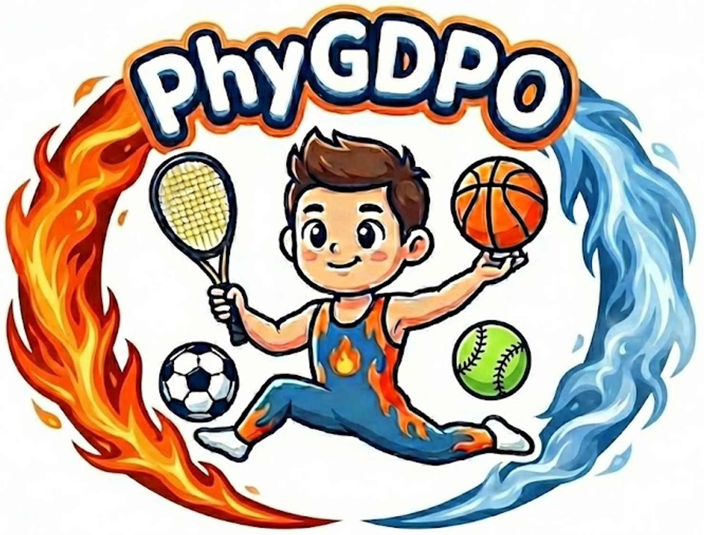
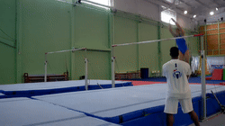
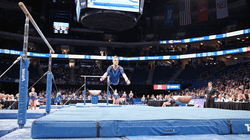
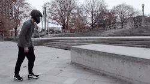
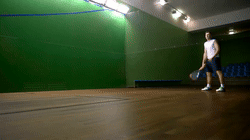

&nbsp;

<div align="center">

<p align="center">  </p>

[](https://ai.meta.com/research/publications/phygdpo-physics-aware-groupwise-direct-preference-optimization-for-physically-consistent-text-to-video-generation/)
[](https://zhuanlan.zhihu.com/p/2060200098131350370)
[](https://arxiv.org/abs/2512.24551)
[](https://caiyuanhao1998.github.io/project/PhyGDPO/)
[](https://huggingface.co/datasets/CaiYuanhao/PhyGDPO)
[](https://huggingface.co/CaiYuanhao/PhyGDPO)
[](https://huggingface.co/spaces/CaiYuanhao/PhyGDPO)

<h3>PhyGDPO: Physics-Aware Groupwise Direct Preference <br> Optimization for Physically Consistent Text-to-Video Generation</h3> 

<p style="font-size: 8px;">
  Applied in the post-training of
  
  <strong>Muse Video</strong> and
  
  <strong>Gemini Omni Flash</strong>
</p>

<p align="center">
<table border="0" cellspacing="0" cellpadding="0" style="border-collapse:collapse;border:0;">

  <!-- ===== Row 1 Prompt ===== -->
  <tr>
    <td colspan="3" align="center" style="border:0;padding:6px 10px;font-style:italic;">
      (1) A gymnast drops from the parallel bars and lands safely on the mat below.
    </td>
  </tr>
  <tr>
    <td style="border:0;padding:10px;">
      
    </td>
    <td style="border:0;padding:10px;">
      
    </td>
    <td style="border:0;padding:10px;">
      
    </td>
  </tr>

  <tr>
    <td align="center" style="border:0;padding-top:6px;font-weight:700;">Ours</td>
    <td align="center" style="border:0;padding-top:6px;font-weight:700;">OpenAI Sora2</td>
    <td align="center" style="border:0;padding-top:6px;font-weight:700;">Google Veo3.1</td>
  </tr>

  <!-- ===== Row 2 Prompt ===== -->
  <tr>
    <td colspan="3" align="center" style="border:0;padding:6px 10px;font-style:italic;">
      (2) A soccer player runs, plants their foot, and drop kicks a soccer ball high into the air, the ball arcing visibly.
    </td>
  </tr>
  <tr>
    <td style="border:0;padding:10px;">
      
    </td>
    <td style="border:0;padding:10px;">
      
    </td>
    <td style="border:0;padding:10px;">
      
    </td>
  </tr>

  <tr>
    <td align="center" style="border:0;padding-top:6px;font-weight:700;">Ours</td>
    <td align="center" style="border:0;padding-top:6px;font-weight:700;">OpenAI Sora2</td>
    <td align="center" style="border:0;padding-top:6px;font-weight:700;">Google Veo3.1</td>
  </tr>

  <!-- ===== Row 3 Prompt ===== -->
  <tr>
    <td colspan="3" align="center" style="border:0;padding:6px 10px;font-style:italic;">
      (3) A person wearing a helmet performs a handspring over a platform.
    </td>
  </tr>
  <tr>
    <td style="border:0;padding:10px;">
      
    </td>
    <td style="border:0;padding:10px;">
      
    </td>
    <td style="border:0;padding:10px;">
      
    </td>
  </tr>

  <tr>
    <td align="center" style="border:0;padding-top:6px;font-weight:700;">Ours</td>
    <td align="center" style="border:0;padding-top:6px;font-weight:700;">OpenAI Sora2</td>
    <td align="center" style="border:0;padding-top:6px;font-weight:700;">Google Veo3.1</td>
  </tr>

  <!-- ===== Row 4 Prompt ===== -->
  <tr>
    <td colspan="3" align="center" style="border:0;padding:6px 10px;font-style:italic;">
      (4) A person plays squash on an indoor court.
    </td>
  </tr>
  <tr>
    <td style="border:0;padding:10px;">
      
    </td>
    <td style="border:0;padding:10px;">
      
    </td>
    <td style="border:0;padding:10px;">
      
    </td>
  </tr>

  <!-- ===== Method Labels ===== -->
  <tr>
    <td align="center" style="border:0;padding-top:6px;font-weight:700;">Ours</td>
    <td align="center" style="border:0;padding-top:6px;font-weight:700;">OpenAI Sora2</td>
    <td align="center" style="border:0;padding-top:6px;font-weight:700;">Google Veo3.1</td>
  </tr>

</table>
</p>


&nbsp;

</div>


### Introduction
This is a re-implementation of our work "PhyGDPO: Physics-Aware Groupwise Direct Preference Optimization for Physically Consistent Text-to-Video Generation" using public datasets and re-trained model based on public codes. In this work, we present a data construction pipeline, PhyAugPipe, that can create data pairs and a new direct preference optimization framework, PhyGDPO, for physically plausile text-to-video generation. If you find our repo useful, please give it a star ⭐ and consider citing our paper. Thank you :)


### News

- **2026.11.24 :** We built an [online demo](https://huggingface.co/spaces/CaiYuanhao/PhyGDPO) on HuggingFace. Welcome to have a try 🤗
- **2026.11.24 :** PhyGDPO now supports **Image-to-Video Generation**. We successfully applied it to **Wan-2.1-Fast-14B** to generate sports videos from a starting frame and a text prompt.
- **2026.11.07 :** New comparison videos with  **Seedance** are now on our [project page](https://caiyuanhao1998.github.io/project/PhyGDPO/) and [Hugging Face](https://huggingface.co/datasets/CaiYuanhao/PhyGDPO_demo/tree/main/Main_Comparison) 🎬
- **2026.11.07 :** Tencent's latest video gen world model  **[Hy-Nomas](https://hy-nomas.hy.tencent.com/)** cites our work and demonstrates that **PhyGDPO can improve the physical consistency of world models**. 🌍
- **2026.08.31 :** The code, data, and models of PhyGDPO are now fully open-sourced. Welcome to use them and share your feedback! 🚀
- **2026.04.10 :** Our PhyGDPO algorithm was applied in the post-training of  **Muse Video**.
- **2026.01.25 :** Our PhyGDPO algorithm was applied in the post-training of  **Gemini Omni Flash**.
- **2026.01.04 :** Our paper is on [arXiv](https://arxiv.org/abs/2512.24551) now. 🚀
- **2026.01.03 :** Our [project page](https://caiyuanhao1998.github.io/project/PhyGDPO/) has been built up. Feel free to check the video generation results on the project page.
- **2025.09.18 :** Our algorithm was deployed in  **Meta's internal video generation framework (MovieGen)**.


&nbsp;
&nbsp;

## 1. Data Construction
To construct training pairs from scratch using the original text-to-video data, follow the [PhyAugPipe guide](PhyAugPipe/README.md). To use our released training pairs, skip this step and follow the download instructions in [DiffSynth-Studio](DiffSynth-Studio/) folder.
&nbsp;

## 2. Model Training and Inference
We use the Wan2.1-T2V-14B as the base model and post-train it with our PhyGDPO framework. Our code is developed based on the DiffSynth GitHub repository. Please enter the [DiffSynth-Studio](DiffSynth-Studio/) folder and refer to its `README.md` for detailed instructions on model training and inference.

&nbsp;

## 3. Citation
```sh
@inproceedings{phygdpo,
  title={PhyGDPO: Physics-Aware Groupwise Direct Preference Optimization for Physically Consistent Text-to-Video Generation},
  author={Cai, Yuanhao and Li, Kunpeng and Jia, Menglin and Wang, Jialiang and Sun, Junzhe and Liang, Feng and Chen, Weifeng and Juefei-Xu, Felix and Wang, Chu and Thabet, Ali and Dai, Xiaoliang and Ju, Xuan and Yuille, Alan and Hou, Ji},
  booktitle={ECCV},
  year={2026}
}
```
